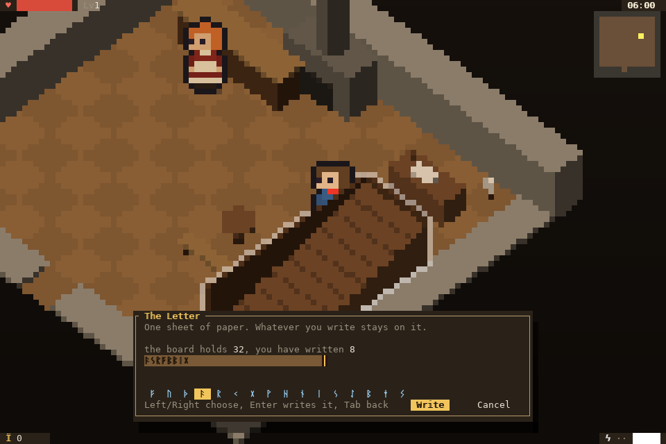
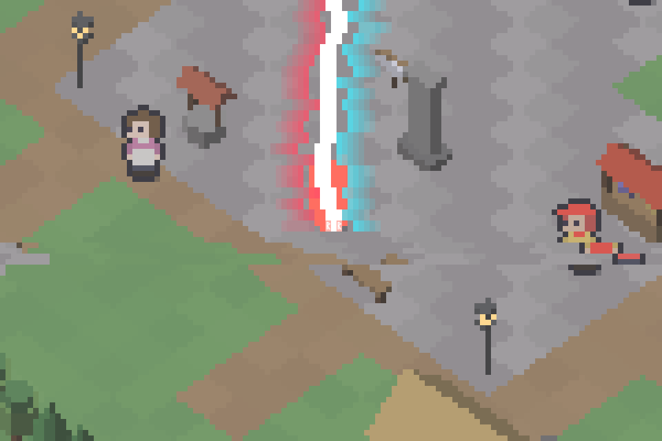

# Heavenly Rules

A small terminal RPG set in the lakeside town of Yunix.
Walk, talk, fight, and write.

## Play

You need Linux x86-64 and a terminal with 24-bit colour and mouse reporting,
at least 80×24, or a desktop for the native window.

    make
    ./build/judgement

`make run` builds and starts it. If `ycc` is not on your `PATH`, pass
`make YCC=/path/to/ycc`.

The game opens a native window with `--window`, or when there is no terminal;
it also runs on Windows (`make win`) and in a browser (`make web`, then
`make webserve`). The browser build is one page and one wasm module at 100%;
the game fills it, and a large window gets bigger text cells while the world
keeps an 80x24 grid. Use `--mute` for silence, `--ascii-runes` for
fonts without the Runic block, and `--scale N` or `--size CxR` to fit the
window.

Saves live in `$XDG_DATA_HOME/heavenly-rules/`, or `~/.local/share/heavenly-rules/`.

## Controls

| | |
|---|---|
| walk | arrow keys, WASD, or click the ground |
| talk / use | E or Enter |
| swing / dodge | Space / C |
| Judgment | J, or right-click |
| writing | type; Tab for the rune palette; Enter writes |
| help | H |
| quit | Q or Ctrl-C |

## Build

Heavenly Rules is written in Y and compiled with
[ycc](https://github.com/octo-kumo/ycc). `make` builds the game,
`make test` drives it on a pty, and `make clean` removes the build.
